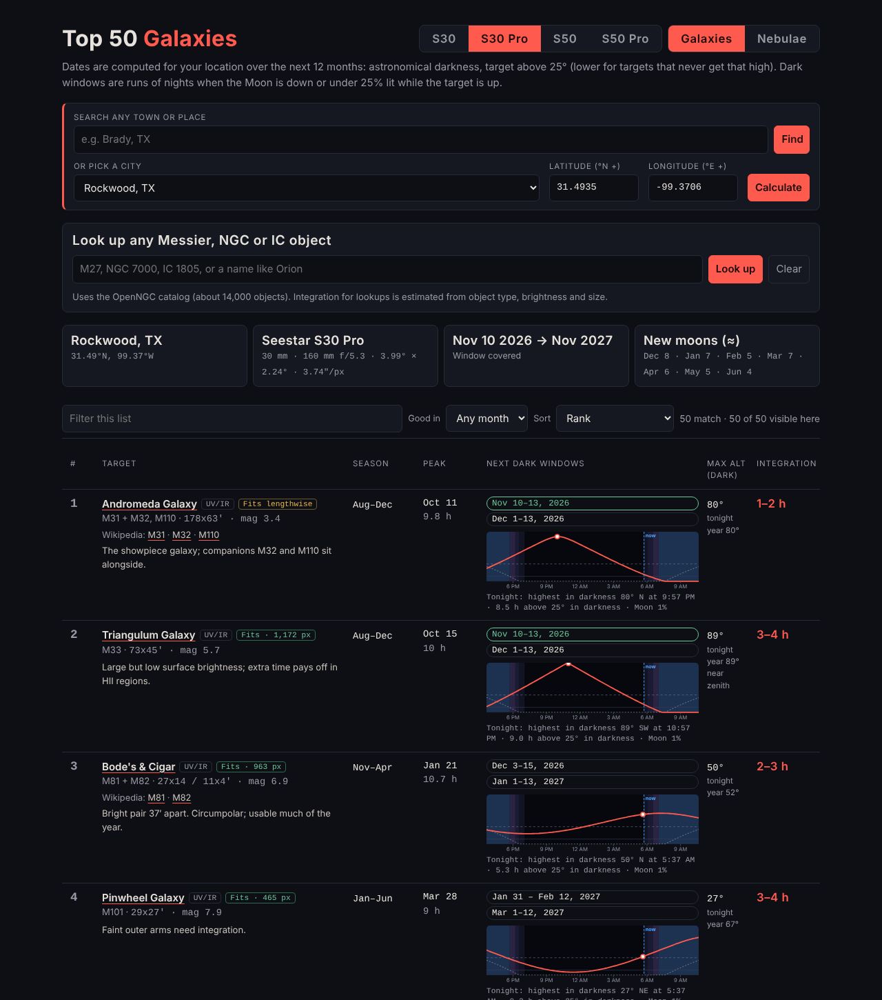

# Seestar Target Planner

Plan galaxy and nebula imaging for ZWO Seestar smart telescopes (S30, S30 Pro, S50 and S50 Pro). Pick your
location and telescope, and the planner shows when each target is best placed, the next moon-dark nights to shoot
it, whether it fits in the frame, and how much total integration to collect.



**Live site:** [letsgodevils.github.io/seestar-target-planner](https://letsgodevils.github.io/seestar-target-planner/)

## Features

- **Top 50 galaxies and top 50 nebulae**, chosen for small-aperture smart telescopes, each with notes, a filter
  recommendation (UV/IR cut or dual-band), a link to the target's Telescopius page and a button that opens the
  Telescopius telescope simulator centred on it.
- **Any location.** Search for a town (OpenStreetMap), pick from a built-in city list, or type coordinates.
- **For each target, over the next 12 months:**
  - season and peak night
  - next two moon-dark windows
  - highest altitude in full darkness, tonight and over the year, with warnings for low targets and for targets
    passing near the zenith (hard for alt-az tracking)
- **Tonight's altitude chart** for each target: altitude curve, Moon, twilight shading and a "now" marker. Hover or
  drag across it to read altitude, direction and time. Click a chart to open a larger copy.
- **Favorite locations:** save places with one click and switch between them from chips above the location box.
- **Favorite targets:** star any target (☆ under its number) and use the Favorites button to show only those.
- **Telescope selector** (S30, S30 Pro, S50, S50 Pro):
  - framing tags: fits, fits lengthwise, small (crop afterward), or the mosaic size needed
  - integration times rescaled for each scope
- **Look up any Messier, NGC or IC object** from the OpenNGC catalog (about 14,000 objects) and get the same details.
- Filter by month (it opens on the current month); sort by next dark window (the default), rank, peak date, integration, framing, max altitude or Moon distance; show 10–50 targets per page or all of them.
- **Red light mode** for use at the telescope: red-only light, dark charts, outlined buttons.
- Works on phones. Your location, favorite locations and targets, telescope, list and page size are remembered in your browser.

## How the numbers are worked out

- A night counts toward a target when the Sun is more than 18° below the horizon (astronomical darkness) and the
  target is above the **Min altitude** setting (default 25°, adjustable from 10° to 50°). For targets that never climb 10° above that setting, the limit is 8° below their highest
  point (never lower than 12°).
- **Dark window:** a run of three or more nights when, for most of the hours the target is up, the Moon is below
  the horizon, less than 25% lit, or far enough from the target: at least 60° for dual-band targets and 90° for
  UV/IR targets.
- **Season:** the months whose average dark hours for the target are at least half of its best night.
- **Framing** compares the target's extent with the telescope's field:

  | Scope | Field | Scale |
  |---|---|---|
  | S30 | 2.13° × 1.20° | 3.99″/px |
  | S30 Pro | 3.99° × 2.24° | 3.74″/px |
  | S50 | 1.28° × 0.72° | 2.39″/px |
  | S50 Pro | 2.45° × 1.38° | 2.30″/px |

- **Integration** is total stacked time with 10–20 s subs. Times are set for the S30 Pro and rescaled by focal
  ratio for the other scopes. All four are about f/5, so the times stay similar; the 50 mm scopes record finer
  detail rather than needing much less time. Times for looked-up objects are estimates based on object type,
  brightness and size.
- Sun and Moon positions use low-precision formulas accurate to a few minutes of time, which is plenty for planning.

## Run it locally

The site is plain HTML, CSS and JavaScript with no build step. It loads its data files over HTTP, so serve the
folder instead of opening `index.html` directly:

```sh
python3 -m http.server 8000
# then open http://localhost:8000
```

## Publish with GitHub Pages

1. Push this repository to GitHub.
2. In the repository, go to **Settings → Pages**.
3. Under **Build and deployment**, choose **Deploy from a branch**, select `main` and `/ (root)`, then **Save**.
4. After a minute the site is live at `https://<your-username>.github.io/<repository-name>/`. Add that link at the
   top of this README.

The empty `.nojekyll` file tells GitHub Pages to serve the files as they are.

## Customize

- **Default location, list, telescope and min altitude:** edit the JSON block with `id="ss-config"` in `index.html`.
- **Target lists:** `data/targets.json`. Each target has a position (J2000), size, magnitude, integration range,
  filter, notes, Wikipedia links and a `frame` size (long × short, arcminutes) used for the framing tags.
- **City list:** `data/cities.json` (`[name, latitude, longitude]`, west and south negative).

## Project layout

```
index.html           page markup, Content Security Policy, settings
css/planner.css      styles
js/planner.js        astronomy, lookups, town search, interface
data/targets.json    top 50 galaxies and nebulae
data/cities.json     built-in city list
data/catalog.json    OpenNGC catalog (CC BY-SA 4.0)
docs/screenshot.png  README image
```

## Privacy

Everything runs in your browser. The only outside request is the town search: when you press **Find**, the place
name you typed is sent to OpenStreetMap's Nominatim service. Nothing else about you leaves the page.

## License

Created by Jeff Boerio.

- Code and target lists: [MIT](LICENSE)
- `data/catalog.json`: derived from [OpenNGC](https://github.com/mattiaverga/OpenNGC) by Mattia Verga,
  [CC BY-SA 4.0](https://creativecommons.org/licenses/by-sa/4.0/)
- Town search: © OpenStreetMap contributors, via [Nominatim](https://nominatim.org/)

See [NOTICE.md](NOTICE.md) for details. Security issues: see [SECURITY.md](SECURITY.md).
